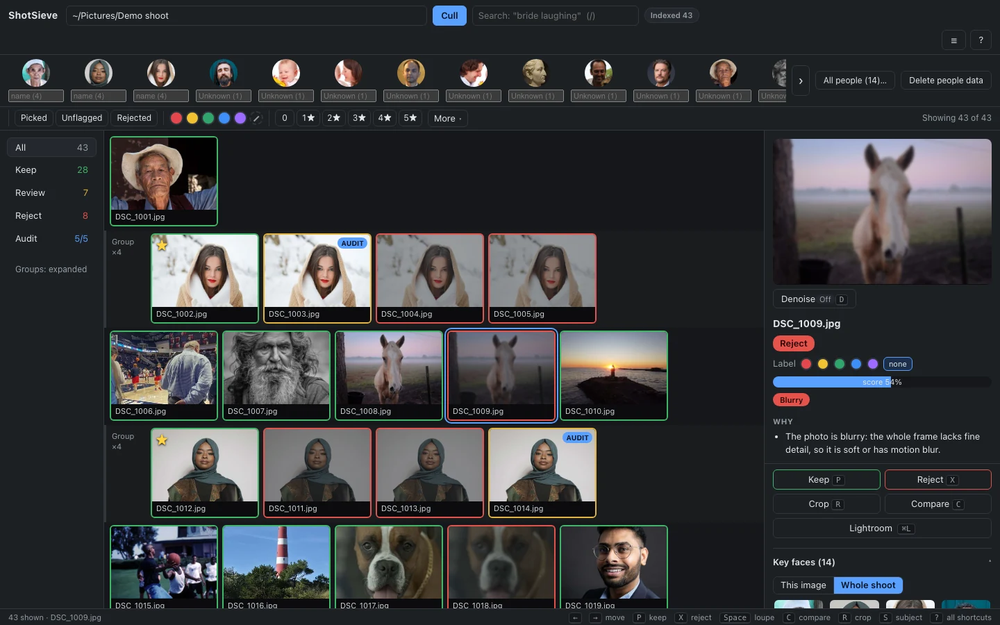
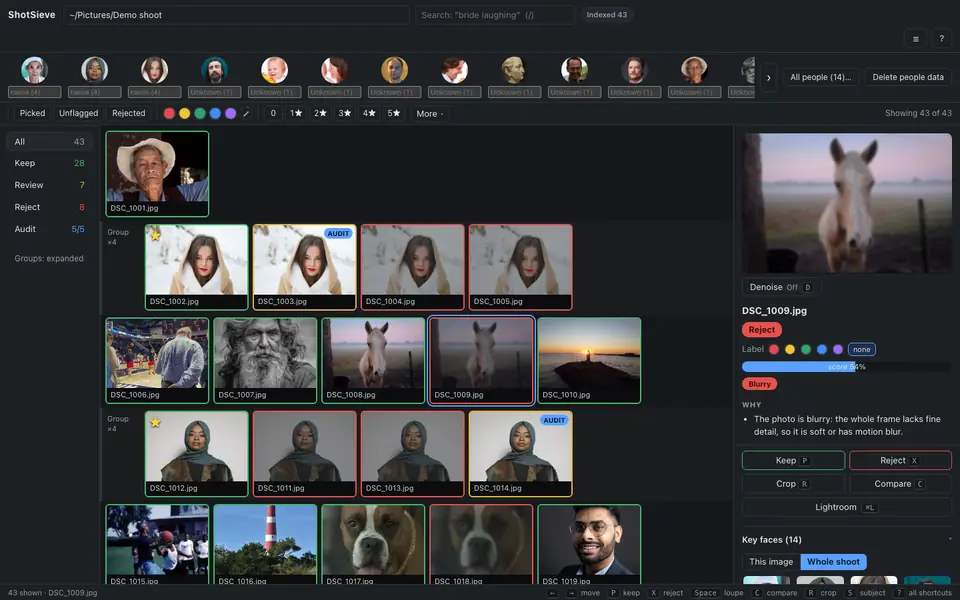
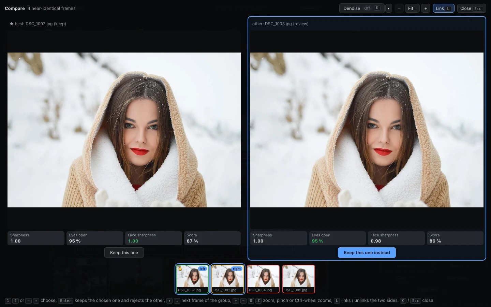
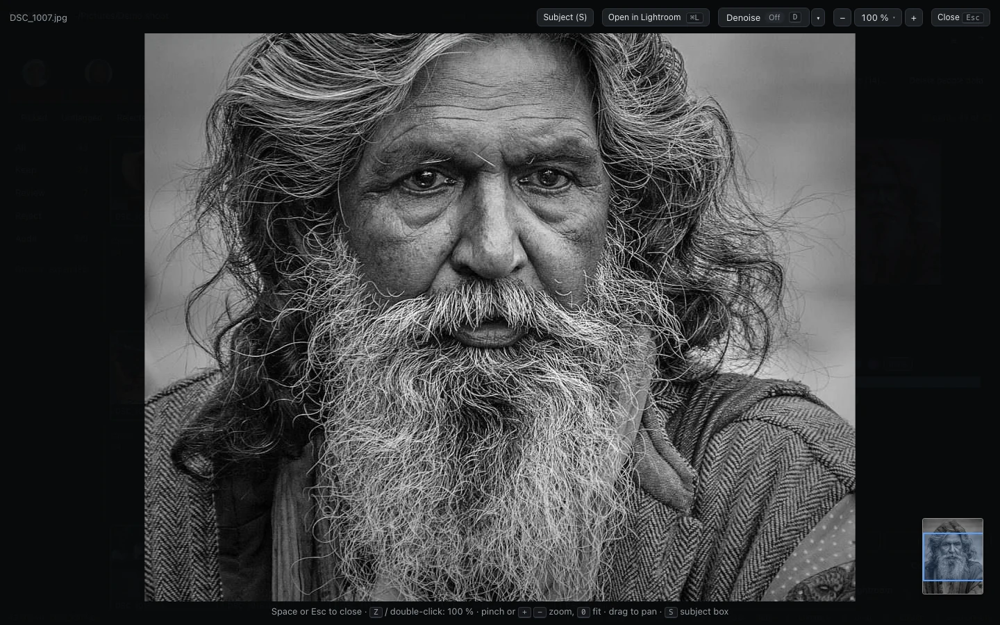
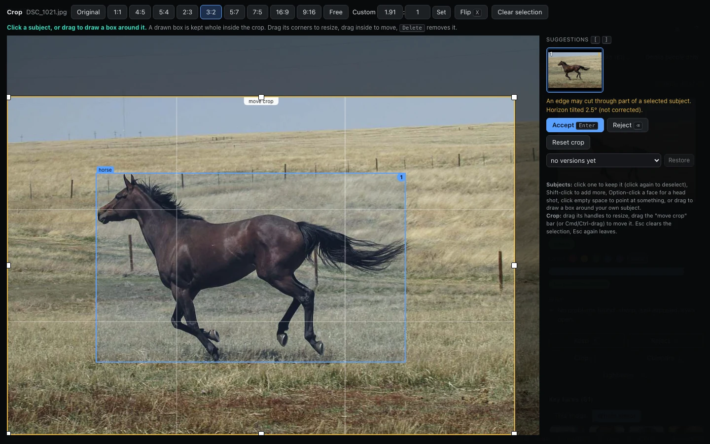
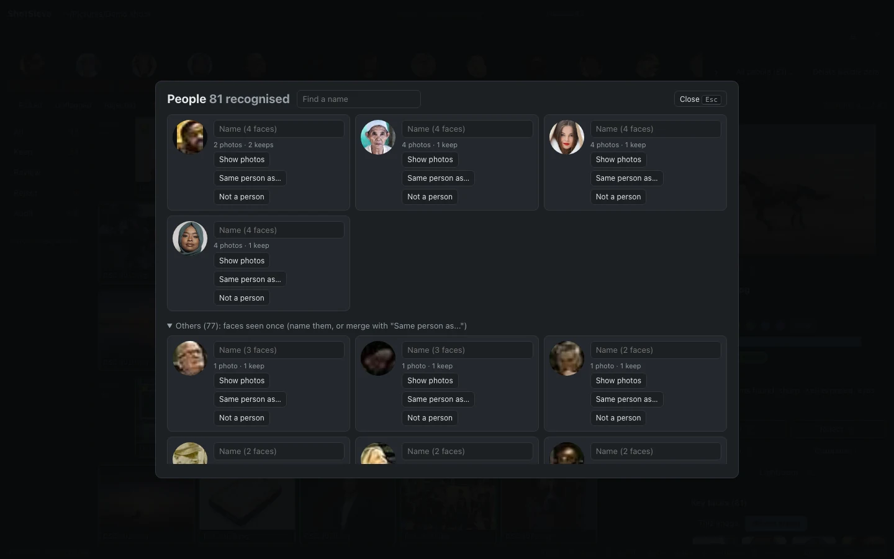
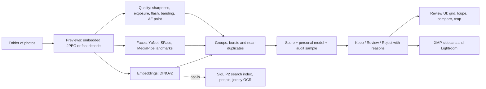

<div align="center">

# ShotSieve

**Private, offline AI photo culling for macOS: no cloud, no subscription.**

[](LICENSE)
[](#system-requirements)
[](pyproject.toml)
[](https://github.com/SiranjeviKrishnan/shotsieve/releases/latest)



[Download](#download--install) ·
[Quick start](#quick-start) ·
[Features](#features) ·
[Privacy](#privacy) ·
[Build from source](#build-from-source)

</div>

ShotSieve sorts a shoot into **Keep**, **Review** and **Reject** on your own Mac, tells you *why*
for every reject (blurry, eyes closed, missed focus, flash misfire, duplicate that is not the best
frame, ...), and hands the result to Lightroom as ratings, labels and XMP sidecars. Your originals
are never modified. The `.dmg` bundles every model, so after the install it **works fully
offline**.

<p align="center"></p>

## Why ShotSieve

- **Private by construction.** Everything runs on the Mac in front of you. The app has no
  telemetry and no account, and the release build makes no network connections: it is tested with
  outbound network denied ([how](#privacy)).
- **Free and open.** Source code Apache-2.0 (the binary `.dmg` also bundles GPL/LGPL components, see [License](#license)). No subscription, no per-photo credits, no upload.
- **Fast.** Measured by `scripts/benchmark.py` on a 10-core Apple Silicon Mac (M1 Pro class,
  32 GB): about **25 photos/s** for a full cull of 2560x1707 JPEGs (24.8 img/s, 300 frames), about
  **15 photos/s** for RAW files (14.6 img/s, DNG), a warm re-cull of an unchanged shoot in under
  a second, and a 10,000-frame shoot culled at 20 img/s with 1.5 GB peak memory. Cull-only memory
  is under 1 GB; the whole benchmark with every feature running in one process (cull, search, OCR,
  video, crops) peaks at about 2.5 GB (2468 MB measured, budget 3 GB; `data/benchmark.md`).
- **Fits your Lightroom workflow.** Ratings, colour labels, flags and crops go to XMP sidecars
  (RAW) and ShotSieve can read your picks back from a Lightroom Classic catalog (read-only) to
  learn your taste. See [Lightroom](#lightroom-integration) for what Lightroom does and does not
  read.

Numbers come from a synthetic benchmark plus small CC0 test sets, not from your shoots: try it on a
shoot you already culled by hand and look at the *Review* and *Audit* buckets before you trust it
with a delivery.

## Features

<details open>
<summary><b>Culling</b></summary>

- **AI culling with reasons.** Every frame gets one decision and every reject gets at least one
  plain-language reason. Uncertain frames go to *Review*, and a small random sample of rejects is
  put in front of you (*Audit*) so you can catch what the model got wrong; your corrections
  calibrate the next shoot.
- **Near-duplicates and compare.** DINOv2 embeddings group look-alike frames and pick the best of
  each group; the side-by-side compare view links zoom and pan, shows sharpness / eyes / score for
  both and lets you swap the keeper with one key.
- **Burst handling.** Frames closer than 2 s are a burst, grouped per camera body (several
  bodies at one event are not mistaken for duplicates; clock offsets between bodies can be
  estimated and corrected).
- **Eyes, sharpness, faces, exposure, flash.** Blink and expression from face landmarks, face-level
  sharpness at a canonical scale, exposure histograms, flash misfire detection, AF-point focus
  check (Canon, Sony), e-shutter banding detection.
- **Personal model.** Train from your past choices (Lightroom catalog or XMP folders); your own
  overrides always win.

</details>

<details open>
<summary><b>Finding and reviewing</b></summary>

- **People and face recognition (opt-in).** Groups the same face across a shoot so you can name
  people, merge or ignore clusters and filter by person. Off until you consent per shoot; delete
  the data any time.
- **Natural-language search.** Type "bride laughing at sunset" (`/`). SigLIP2 runs locally; filters
  such as `person:"Name"`, `jersey:23`, `is:keep`, `camera:SERIAL` combine with the text.
- **Filters, stars, labels, picks.** A filter bar (people any/all, flags, colour labels, stars,
  orientation, camera, lens, warnings), keyboard-first multi-select, batch keep / reject / stars /
  labels, Move to Trash (never a hard delete, with Undo).
- **Full-screen loupe with zoom.** 100 % and pinch zoom on the full-resolution image, a navigator
  for panning, and an optional AI **denoise** for viewing (view only, the file never changes).
- **Shot-list alerts.** Load a shot list (wedding, sports, corporate templates included) and see
  which must-have shots are covered and which are missing, before you leave the venue.
- **Jersey numbers (opt-in).** OCR reads numbers so you can search `jersey:23`; map numbers to
  names with a roster CSV.
- **Video frame-grabs (opt-in).** Culls frame candidates from video clips and exports the picks
  as JPEGs.

</details>

<details open>
<summary><b>Editing helpers</b></summary>

- **Crop suggestions (Beta).** Click a subject or draw a box and ShotSieve suggests crops at your
  ratios that keep it whole, with warnings when an edge may cut a subject or the horizon is tilted;
  accepted crops are written as non-destructive Lightroom crop settings. This is the newest
  feature and the least proven: on held-out photos it does not always keep the labelled subject
  whole. The measured numbers and open misses are in [docs/11_CROP.md](docs/11_CROP.md) and
  [docs/TASKS.md](docs/TASKS.md).
- **Editing profile and colour match.** Learn your develop settings from a catalog and predict
  them, or copy the exposure / white balance of a reference frame to look-alike frames.

</details>

<p align="center">




</p>

<sub>Screenshots use only CC0 test photos (see `tests/fixtures/*/LICENSES.md`), regenerated by
`scripts/make_screenshots.py`.</sub>

## Download & install

1. Download `ShotSieve-<version>-arm64.dmg` from the
   [latest release](https://github.com/SiranjeviKrishnan/shotsieve/releases/latest)
   (about 1 GB to download, 1.6 GB installed: it contains every model). Optionally check it
   against the `.sha256` file:
   `shasum -a 256 -c ShotSieve-<version>-arm64.dmg.sha256`.
2. Open the `.dmg` and drag **ShotSieve** onto **Applications**.
3. **First open (the app is not signed by Apple).** ShotSieve is built by the community without a
   paid Apple Developer ID, so macOS blocks it the first time. Use the route for your macOS:
   - **macOS 15 (Sequoia) and newer:** open **ShotSieve** (double-click it in Applications); macOS
     says it cannot verify it; click **Done**. Then open **System Settings > Privacy & Security**,
     scroll down to "ShotSieve was blocked to protect your Mac" and click **Open Anyway**, enter
     your password, and click **Open Anyway** once more in the dialog that follows.
     (On macOS 15 right-click > Open no longer bypasses the check.)
   - **macOS 14 (Sonoma):** Control-click (right-click) **ShotSieve** in Applications, choose
     **Open**, then **Open** again.
   - **Last resort, from a terminal** (any version):
     `xattr -dr com.apple.quarantine /Applications/ShotSieve.app`

   You only have to do this once. The app is ad-hoc code-signed (required for Apple Silicon) but
   not notarised; you can read exactly what is in it in this repository and rebuild it yourself
   ([Build from source](#build-from-source)).

## Quick start

1. **Open ShotSieve.** A short setup assistant walks you through your first shoot (nothing is
   downloaded: the models are inside the app).
2. **Choose a folder** of photos (RAW, JPEG, HEIC, DNG, video optional) and press **Cull**. It
   runs in the background; the grid fills with Keep / Review / Reject as it goes.
3. **Review.** Arrow keys to move, <kbd>P</kbd> keep, <kbd>X</kbd> reject, <kbd>Space</kbd> loupe,
   <kbd>C</kbd> compare. Ratings and labels are written to XMP sidecars next to your RAW files
   (on by default; turn it off in the app menu); import or refresh the folder in Lightroom.

### Keyboard shortcuts

| Key | Action |
|---|---|
| <kbd>←</kbd> <kbd>→</kbd> / <kbd>↑</kbd> <kbd>↓</kbd> | Previous / next image, previous / next group |
| <kbd>Space</kbd> | Loupe (full screen) |
| <kbd>P</kbd> / <kbd>X</kbd> | Keep / reject (again: back to the AI decision) |
| <kbd>1</kbd>-<kbd>5</kbd>, <kbd>0</kbd> | Star rating, clear |
| <kbd>6</kbd> <kbd>7</kbd> <kbd>8</kbd> <kbd>9</kbd> | Colour label red / yellow / green / blue |
| <kbd>C</kbd> | Compare with the group's best (<kbd>1</kbd> <kbd>2</kbd> choose, <kbd>Enter</kbd> keep chosen) |
| <kbd>Z</kbd>, <kbd>+</kbd> <kbd>-</kbd> <kbd>0</kbd> | Zoom: 100 % toggle, in / out / fit |
| <kbd>D</kbd> | Denoise for viewing |
| <kbd>S</kbd> | Subject mode: draw a box around your subject |
| <kbd>R</kbd> | Crop suggestions (Beta); <kbd>Enter</kbd> accept, <kbd>Backspace</kbd> reject |
| <kbd>/</kbd> or <kbd>Cmd</kbd>+<kbd>F</kbd> | Search |
| <kbd>Shift</kbd>+<kbd>F</kbd> / <kbd>Shift</kbd>+<kbd>P</kbd> | Filter bar / People |
| <kbd>Cmd</kbd>+<kbd>click</kbd>, <kbd>Shift</kbd>+<kbd>click</kbd>, <kbd>Cmd</kbd>+<kbd>A</kbd> | Multi-select |
| <kbd>Cmd</kbd>+<kbd>Delete</kbd>, <kbd>Cmd</kbd>+<kbd>Z</kbd> | Move to Trash, undo |
| <kbd>Cmd</kbd>+<kbd>L</kbd> | Open in Lightroom |
| <kbd>A</kbd>, <kbd>G</kbd>, <kbd>Tab</kbd> | Next audit item, collapse groups, cycle tabs |
| <kbd>?</kbd> | The full cheat-sheet |

## How it works



The pipeline is a set of concurrent stages (decode, features, faces, embeddings, grouping,
scoring), so wall time is roughly that of the slowest stage. Results are cached per shoot, which is
why a re-cull of an unchanged shoot takes under a second and new files are processed
incrementally. The design and the budgets are in [docs/](docs/): start with
[00_OVERVIEW](docs/00_OVERVIEW.md), [01_ARCHITECTURE](docs/01_ARCHITECTURE.md) and
[03_PIPELINE](docs/03_PIPELINE.md).

## Models

All models ship inside the `.dmg` (about 990 MB), are pinned to a commit and verified by sha256 at
build time, and all licences allow redistribution. Full details, sources and citations:
[THIRD_PARTY_NOTICES.md](THIRD_PARTY_NOTICES.md).

| Model | Task | Licence | Size |
|---|---|---|---|
| YuNet (2023mar) | Face detection | MIT | 0.2 MB |
| SFace (2021dec) | Face recognition | Apache-2.0 | 38.7 MB |
| MediaPipe Face Landmarker | Blink / expression / landmarks | Apache-2.0 | 3.8 MB |
| DINOv2-small | Near-duplicates, scene embeddings | Apache-2.0 | 88.5 MB |
| SigLIP2-B/16 (vision fp32, text int8, tokenizer) | Natural-language search | Apache-2.0 | 689.6 MB |
| PP-OCR det v3 + rec (English) | Jersey numbers | Apache-2.0 | 10.3 MB |
| YOLOX-s | Subject detection for crops (Beta) | Apache-2.0 | 35.9 MB |
| NAFNet-SIDD-width32 | Denoise for viewing | MIT | 124.0 MB |

## Privacy

- **No network after install.** ShotSieve does not phone home and has no analytics. The release app
  never downloads a model: it refuses to, because every model is already inside it. This is tested
  (`tests/test_release_bundle.py` runs the app under a sandbox that denies all outbound network and
  culls, searches, crops and denoises with it). The only socket the app opens is its own
  `127.0.0.1` server for its window.
- **Where things are stored.**
  - Your photos are never modified. Per shoot, ShotSieve keeps a `.shotsieve/` folder inside the
    shoot (cache, thumbnails, your decisions, face data) and, if you leave it on, XMP sidecars
    next to your RAW files.
  - App-wide data: `~/Library/Application Support/ShotSieve/` (settings, recent folders, window
    position, personal model) and logs in `~/Library/Logs/ShotSieve/`.
- **Face data is opt-in** per shoot, stays in that shoot's `.shotsieve/` folder and can be wiped
  with **Delete people data**.
- **Delete everything.** Quit ShotSieve, drag it to the Trash, delete
  `~/Library/Application Support/ShotSieve` and `~/Library/Logs/ShotSieve`, and delete the
  `.shotsieve/` folders (and `.xmp` sidecars, if you do not want them) in your shoots.

## System requirements

- **Apple Silicon Mac** (M1 or newer). The `.dmg` is arm64 only.
- **macOS 14 (Sonoma) or newer** (the bundled numpy, onnxruntime and mediapipe are built for 14).
- **16 GB RAM recommended** (a cull alone peaks under 1 GB; everything running at once peaks at
  about 2.5 GB, budget 3 GB, checked in the benchmark). 8 GB Macs should work for culling but are
  not a tested target.
- **About 1.6 GB of disk** for the installed app (the `.dmg` download is about 1 GB), plus space
  for each shoot's cache.

## Lightroom integration

Lightroom Classic reads XMP sidecars **only for proprietary RAW**. For JPEG, TIFF, PNG, HEIC and
DNG it reads the metadata embedded in the file, so it does not see sidecars for those (Bridge,
Capture One and darktable do). ShotSieve warns you when a shoot contains such files. An existing
rating or label of yours is never overwritten unless you override that image in ShotSieve. The
catalog sync (`shotsieve sync --lrcat`) opens your `.lrcat` read-only (a private copy for a
catalog in WAL mode) and never writes it.

## Build from source

You need an Apple Silicon Mac with Xcode command line tools (for the launcher).

```bash
git clone https://github.com/SiranjeviKrishnan/shotsieve && cd shotsieve
./install.sh --dev                              # uv, Python 3.11, locked deps, core models, dev ShotSieve.app
uv run python scripts/fetch_models.py           # all models (about 1.4 GB, sha256-verified)
uv run pytest -q -m "not models"                # fast tests, no model files needed
uv run shotsieve app                            # or: open ShotSieve.app (the dev app runs from this folder)

scripts/build_release.sh                        # dist/ShotSieve.app + dist/ShotSieve-<version>-arm64.dmg (+ .sha256)
uv run pytest -q -m release                     # prove dist/ShotSieve.app works away from the repo, offline
```

Other entry points: `shotsieve cull <folder>`, `shotsieve serve <folder>` (the UI in a browser at
`127.0.0.1`), `shotsieve doctor`. The release build embeds a relocatable Python
(python-build-standalone via uv), installs the locked dependencies into it, copies the models and
ad-hoc signs the bundle; see the header of [scripts/build_release.sh](scripts/build_release.sh).
Source installs also run on Intel Macs (CPU only, slower), but those are not a tested target.

## Limitations

- Apple Silicon and macOS 14+ only for the `.dmg`; not signed or notarised (see the first-open
  steps); no auto-update (download a new `.dmg`).
- The decision model targets a missed-keeper rate under 1 %, measured on a synthetic benchmark and
  small CC0 sets; calibrate it with your own audit decisions and keep an eye on the Review bucket.
- Crop suggestions are **Beta**. Natural-language search, people and jersey OCR need their indexer
  to finish first (it runs in the background and pauses while you cull).
- The release bundle contains GPL-licensed codecs through the OpenCV and pillow-heif wheels; read
  [THIRD_PARTY_NOTICES.md](THIRD_PARTY_NOTICES.md) before redistributing the `.dmg`.
- Only English jersey OCR; faces need roughly 24 px or more to be recognised reliably.

## Roadmap

Open ideas, none promised: Developer-ID signing and notarisation, a universal / Intel build,
album sequencing, a learned crop taste, a permissive-only build without the GPL codecs, Windows
and Linux ports of the core pipeline. See [docs/06_ROADMAP.md](docs/06_ROADMAP.md) and
[docs/TASKS.md](docs/TASKS.md) for what is done.

## Contributing

Bug reports, ideas and pull requests are welcome: see [CONTRIBUTING.md](CONTRIBUTING.md). Security
issues: [SECURITY.md](SECURITY.md). Everything that is published passes
`scripts/privacy_check.sh`.

## License

ShotSieve's **source code is Apache-2.0** ([LICENSE](LICENSE), Copyright 2026 The ShotSieve
Authors). The **binary `.dmg` bundles third-party components under their own licences, including
GPL-2.0-or-later / GPL-3.0 parts (FFmpeg, x264, x265) and LGPL parts, so the `.dmg` as a whole is
not purely Apache-2.0.** The licences, exact versions and the corresponding source (attached to
every release as `ShotSieve-<version>-gpl-sources.tar.gz`, with a written offer) are in
[THIRD_PARTY_NOTICES.md](THIRD_PARTY_NOTICES.md).

## Acknowledgements

ShotSieve stands on the work of the authors of YuNet (Shiqi Yu et al.) and SFace (Zhong et al.) via
OpenCV Zoo, MediaPipe (Google), DINOv2 (Meta AI), SigLIP 2 (Google; ONNX conversions by
onnx-community), PaddleOCR (PaddlePaddle; ONNX by monkt), YOLOX (Megvii), NAFNet (Megvii; TFLite by
litert-community, ONNX by mlboydaisuke), and of ONNX Runtime, OpenCV, NumPy, SciPy, scikit-learn,
FastAPI, pywebview, LibRaw / rawpy, Pillow and the other packages listed in
[THIRD_PARTY_NOTICES.md](THIRD_PARTY_NOTICES.md). Test photos are CC0 / public domain from
Wikimedia Commons and raw.pixls.us (attributions in `tests/fixtures/*/LICENSES.md`).
